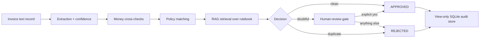

# Automated invoice reimbursement — Bramblewick Finance (fictional)

> **Recruiter summary.** Expense claims arrive as messy invoice records; this
> project turns them into payable-or-review decisions that a finance team can
> audit. It pulls typed fields out of each record with a confidence score,
> checks the money three ways, compares the claim with a written rulebook,
> pulls the governing rule passage back for every decision, and sends shaky
> or large claims to a named human. Proof: 64 tests, all passing, run with
> system Python 3.12 and pytest 9.1.1 — no mocks of the pipeline itself.

**All data is synthetic.** The firm, vendors, employees, invoices, and rules
are invented for this portfolio project. This is an independent project by
its author and is not affiliated with, endorsed by, or connected to any
university, training provider, or real employer.

## What it does

1. **Ingest** a plain-text invoice record and extract typed fields
   (vendor, invoice number, date, category, line items, subtotal, tax,
   total) with a confidence score that falls for every missing or
   unparsable field.
2. **Validate** the money: line items must sum to the subtotal, subtotal +
   tax must equal the total, tax must match subtotal × rate, and each line
   must equal quantity × unit price. Duplicates (same vendor, invoice
   number, and total) are rejected.
3. **Match policy** against a synthetic rulebook
   (`data/policy_rulebook.md`), citing the exact rule id behind each
   decision — meals $75/day, lodging $180/night, office $500/claim, travel
   $1000/claim, receipt rules, and a $1000 approval threshold.
4. **Retrieve** the governing passage for each decision with a deterministic
   keyword retriever (no hosted model, no network call), so the audit trail
   shows *which* passage justified the outcome.
5. **Gate** anything doubtful: low-confidence extraction, money mismatch,
   policy breach, or an amount above $1000 goes to human review. Approval
   there is named-person, single-use, scoped to one claim, and expiring.

## Architecture



See [docs/architecture.md](docs/architecture.md) and
[knowledge/architecture.md](knowledge/architecture.md).

## Run it (offline, standard library only)

```bash
python3 -m pytest
python3 -m invoice_reimbursement.demo
```

Real output from the demo (sample invoice, 2 lines, $70.20 total):

```
claim: CLM-DEMO-001
outcome: APPROVED
payable_cents: 7020
confidence: 1.0
citations: POL-OFFICE-01, POL-RECEIPT-01, POL-THRESHOLD-01, POL-DUP-01
retrieved_passages: POL-OFFICE-01, POL-LODGE-01, POL-MEAL-01
reasons: (none)
```

Test suite (system python3/pytest, run from the repo root):

```
64 passed in 0.13s
```

No virtual environment is used inside the repo, and nothing here deploys
anywhere or publishes any package. There are no CI badges: no workflow
files ship with this scaffold.

## Built / Written-not-run / Planned

| Status | Item |
| --- | --- |
| Built | Ingestion + typed extraction with confidence scoring |
| Built | Money cross-checks, duplicate detection, policy matching, RAG retrieval |
| Built | Human-review gate + named-person, single-use, scoped, expiring approvals |
| Built | View-only SQLite authorizer, row cap, PII redaction, dry-run notifications |
| Built | 64 tests, all passing (see test list in docs/guardrails.md) |
| Written-not-run | Nothing — every shipped module is covered by the passing suite |
| Planned | PDF parsing for scanned invoices, multi-currency totals, a web review UI |

## Docs

- [Purpose](docs/purpose.md) · [How it works](docs/how-it-works.md) ·
  [Code excerpts](docs/code-excerpts.md) · [How to run](docs/how-to-run.md)
- [Guardrails](docs/guardrails.md) · [Limitations](docs/limitations.md) ·
  [Built vs planned](docs/built-vs-planned.md)
- [Implementation guide](docs/implementation-guide.md) ·
  [Interview points](docs/interview-points.md)
- [Threat model](docs/threat-model.md) · [ADRs](docs/adr.md) ·
  [Related repos](docs/related-repos.md)
- [knowledge/notes.md](knowledge/notes.md) — distilled design notes, in the
  author's own words, from a published finance-AI programme brochure
  (patterns only; no brochure text is reproduced — 8-word overlap check: 0 hits).
