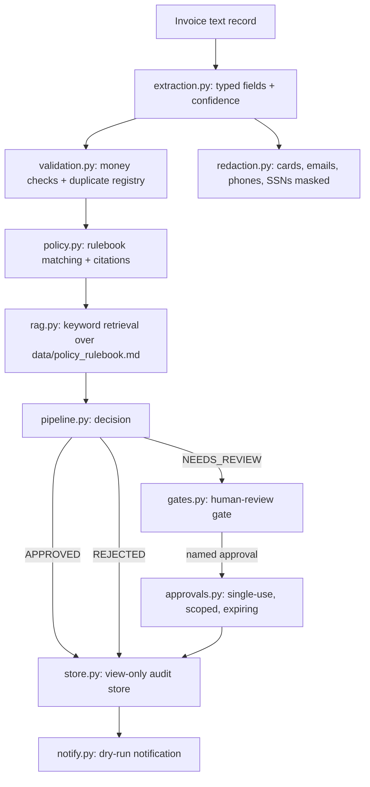

# Architecture

## Module map

| Module | Job |
| --- | --- |
| `extraction.py` | Parse the record; score confidence; drop bank/card fields |
| `validation.py` | Decimal money checks; duplicate registry |
| `policy.py` | Synthetic rulebook; per-decision rule citations |
| `rag.py` | Deterministic keyword retrieval over the rulebook |
| `gates.py` | Human-review gate with strict consent handling |
| `approvals.py` | Named-person, single-use, scoped, expiring approvals |
| `store.py` | SQLite with a view-only authorizer and a fetchmany row cap |
| `budget.py` | Cost inputs that reject negatives |
| `notify.py` | Dry-run-by-default notifications, refused in CI |
| `brandcheck.py` | Hashed blocklist guard for names the repo must not use |
| `pipeline.py` | Orchestrates the whole flow into one auditable decision |

## Data flow

Raw text never reaches the audit store unexamined: extraction strips
sensitive fields, validation and policy checks run on Decimal values, and
only the decision (outcome, payable cents, citations, retrieved passages,
reasons) is recorded. Reads of that store go through public views only.
