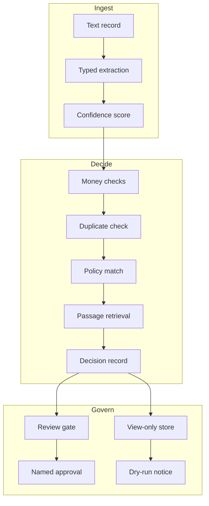

# Architecture (knowledge note)

The three layers stay separate on purpose. Ingest knows nothing about
policy; Decide knows nothing about who approves; Govern knows nothing
about parsing. A change in one layer (for example, swapping keyword
retrieval for embeddings) touches one module and its tests, not the
decision record format.
